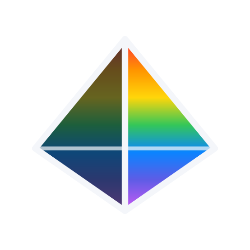
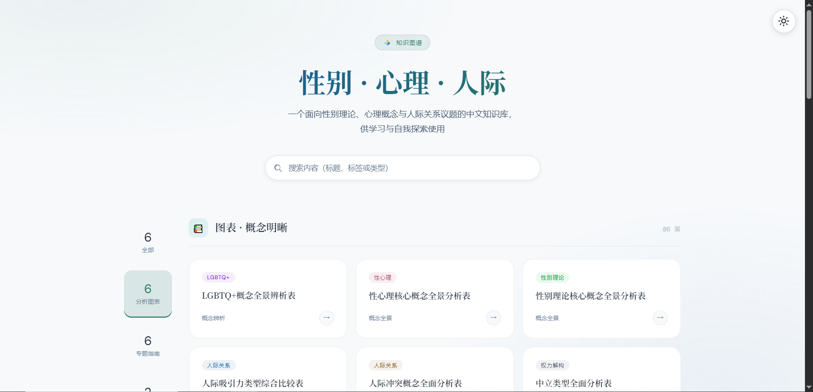
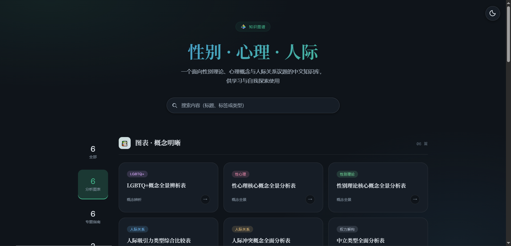

# PrismSelf

  

  <strong>性别 · 心理 · 人际</strong> 
  面向性别理论、心理概念与人际关系议题的中文知识库

  
  
  

## 项目简介

PrismSelf 是一个以静态网页形式呈现的中文知识库，围绕性别理论、心理概念与人际关系议题，整理概念分析、专题指南、术语索引、社群记录、共鸣刻度、自评量表和关系沟通工具。

无需注册即可访问内容和使用工具。

## 功能概览

- 首页导航：提供站内搜索、分类筛选、最近更新与内容入口。
- 概念分析：梳理性别理论、心理概念、人际吸引与冲突等主题。
- 专题指南：整理谱系身份、性别术语与关系议题等长篇内容。
- 自评量表：在浏览器本地作答，生成用于自我梳理的结果说明。
- 共鸣刻度：以宾果式条目记录谱系、性别与神经多样性体验。
- 关系工具：梳理亲密关系需求、沟通偏好与个人边界，制作可选配色与字体的自我介绍卡并导出图片。

## 界面预览

  
   
  

## 使用方式

### 在线访问

访问 <https://prismself.vip> 即可。

## 隐私与数据

- 自评量表、关系工具和导出内容默认在浏览器本地处理。
- 自我介绍卡中的在线字体只在主动选中时从 jsDelivr 下载所需字形，不会上传填写内容；读取本机字体列表需经浏览器授权，仅在本地使用。
- 本项目不要求注册账号，也不以知识库功能为目的收集访问者填写的个人结果。
- 如果主动截图、导出或分享页面结果，请先确认其中不包含不愿公开的信息。

## 内容边界

- 内容用于学习与自我探索，不构成医疗、心理、法律或其他专业建议。
- 页面中的自评量表、共鸣刻度和互动工具不能替代正式评估、诊断、身份判定或专业支持。
- 涉及身份、社群和关系议题的内容以尊重差异、避免污名化和避免替读者下结论为原则。
- 术语解释会尽量保留必要语境；同一概念在不同学科、传统或社群中可能存在不同定义和用法。

## 许可协议

本知识库采用双许可：

- 代码与工程文件：MIT License，见 [LICENSE](./LICENSE)。
- 文档及网站预设内容：Creative Commons Attribution-NonCommercial-ShareAlike 4.0 International（CC BY-NC-SA 4.0），仅授权非商业使用，改编内容须以相同方式共享；见 [LICENSE-CONTENT.md](./LICENSE-CONTENT.md)。

第三方软件、内容和外部服务不因被本项目引用、加载或展示而自动纳入上述许可；第三方量表材料、参与者原始表达、未公开原始数据和个人信息等具体边界见 [THIRD-PARTY-NOTICES.md](./THIRD-PARTY-NOTICES.md)。

## 反馈与贡献

内容纠错和功能建议请提交至 [Issues](https://github.com/KrelinnBios/PrismSelf/issues)。
