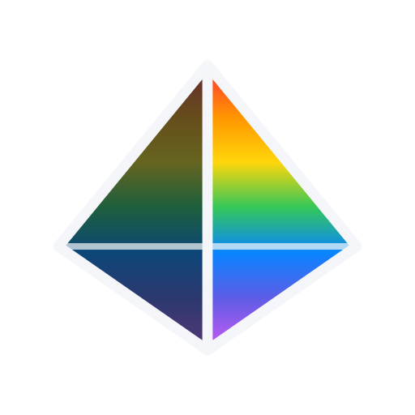
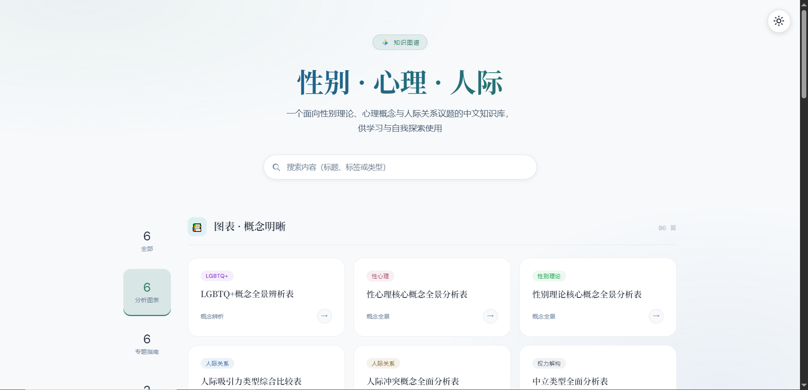
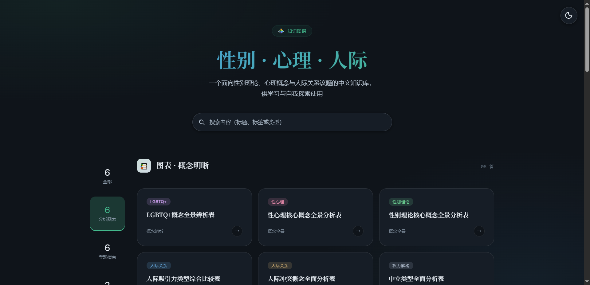

# PrismSelf

  

  <strong>性別 · 心理 · 人際</strong> 
  圍繞性別理論、心理概念與人際關係的中文知識庫

  
  
  

  <a href="README.md">简体中文</a> ·
  <a href="README.zh-TW.md">繁體中文</a>

## 專案簡介

PrismSelf 是圍繞性別理論、心理概念與人際關係的中文知識庫，提供概念分析、專題指南、術語索引、社群記錄、共鳴刻度、自評量表和關係溝通工具。無需註冊即可存取內容和使用工具。

## 功能概覽

- 首頁導覽：提供站內搜尋、分類篩選、最近更新與內容入口。
- 概念分析：梳理性別理論、心理概念、人際吸引與衝突等主題。
- 專題指南：整理譜系身分、性別術語與關係議題等長篇內容。
- 自評量表：在瀏覽器本機作答，產生用於自我梳理的結果說明。
- 共鳴刻度：以賓果式條目記錄譜系、性別與神經多樣性體驗。
- 關係工具：梳理親密關係需求、溝通偏好與個人邊界，製作可選配色與字型的自我介紹卡並匯出圖片。

## 介面預覽

  
   
  

## 使用方式

### 線上存取

造訪 <https://prismself.vip> 即可。

全站頁面預設跟隨瀏覽器的中文語言偏好；未設定中文時顯示簡體。在首頁手動切換後，全站會優先使用本機儲存的選擇。

## 隱私與資料

- 自評量表、關係工具與匯出內容預設在瀏覽器本機處理。
- 自我介紹卡中的線上字型只在使用者主動選取時從 jsDelivr 下載所需字形，不會上傳填寫內容；讀取本機字型清單需經瀏覽器授權，僅在本機使用。
- 生產環境的頁面會載入 VibeCafé 訪問統計腳本，用於匿名統計頁面瀏覽量：它在瀏覽器本機產生隨機訪客 ID（localStorage 鍵名以 `vc:telemetry:visitor:` 開頭），並以不攜帶 Cookie 的要求回報 pageview 事件，不涉及量表、工具或匯出內容的任何資料。瀏覽器啟用「禁止追蹤」（DNT）或 Global Privacy Control（GPC）時不會收集和回報；本機預覽環境不載入該腳本。詳見 [THIRD-PARTY-NOTICES.md](./THIRD-PARTY-NOTICES.md)。
- 本專案不要求註冊帳號，也不以知識庫功能為目的收集訪客填寫的個人結果。
- 如果主動截圖、匯出或分享頁面結果，請先確認其中不包含不願公開的資訊。

## 內容邊界

- 內容用於學習與自我探索，不構成醫療、心理、法律或其他專業建議。
- 頁面中的自評量表、共鳴刻度和互動工具不能取代正式評估、診斷、身分判定或專業支援。
- 涉及身分、社群和關係議題的內容以尊重差異、避免污名化和避免替讀者下結論為原則。
- 術語解釋會盡量保留必要語境；同一概念在不同學科、傳統或社群中可能存在不同定義和用法。

## 授權條款

本知識庫採用雙授權：

- 程式碼與工程檔案：MIT License，見 [LICENSE](./LICENSE)。
- 文件及網站預設內容：Creative Commons Attribution-NonCommercial-ShareAlike 4.0 International（CC BY-NC-SA 4.0），僅授權非商業使用，改編內容須以相同方式共享；見 [LICENSE-CONTENT.md](./LICENSE-CONTENT.md)。

第三方軟體、內容和外部服務不因被本專案引用、載入或展示而自動納入上述授權；第三方量表材料、參與者原始表達、未公開原始資料和個人資訊等具體邊界見 [THIRD-PARTY-NOTICES.md](./THIRD-PARTY-NOTICES.md)。

## 回饋與貢獻

內容糾錯與功能建議請提交至 [Issues](https://github.com/KrelinnBios/PrismSelf/issues)。
